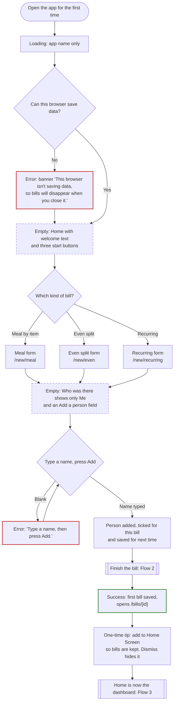
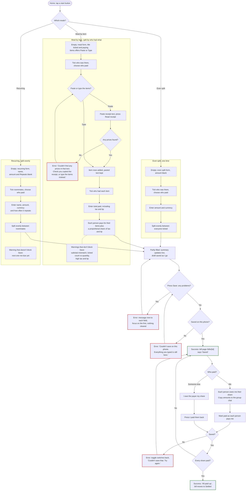

# Bill Splitter

A bill splitter for group meals, one-time costs like Uber rides, and recurring bills like utilities, shared with friends, roommates and my partner. It's for me: I'm usually the one who paid, and I split on my phone right after paying. It also tracks what I owe when someone else pays, like a roommate covering the utilities. Everything is saved on my phone only, so friends don't need an account or the app.

**Main task:** add a bill → choose who was there, who paid and how to split it → see who owes whom → mark it paid.

## Flows

States are named in the box text, and each kind also has its own outline: **Error:** red, **Empty:** dashed, **Success:** green. Rounded boxes are where a flow starts, and double-edged boxes hand off to another flow. The screens, states and exact error messages are in [flows.md](flows.md).

### 1. First visit, nothing saved

### 2. Main task

### 3. Coming back next week or next month

