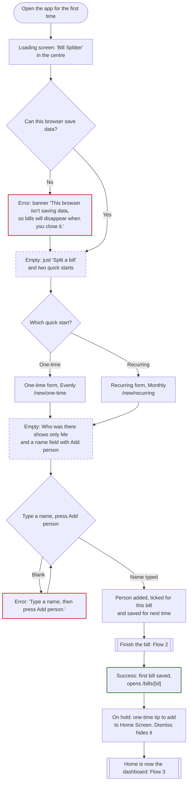
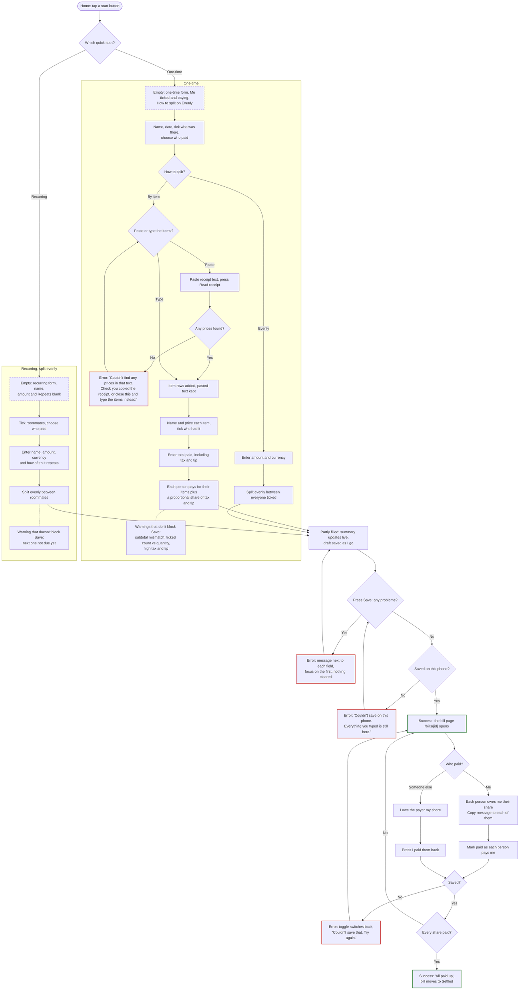
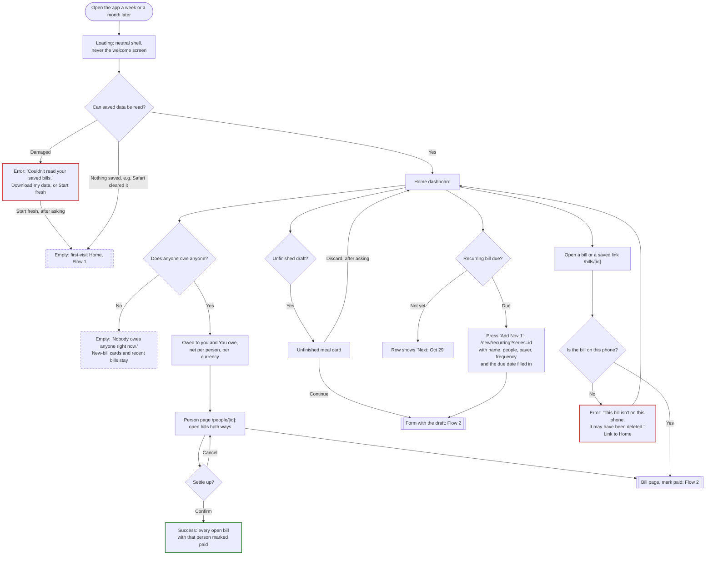

# Bill Splitter

A bill splitter for group meals, one-time costs like Uber rides, and recurring bills like utilities, shared with friends, roommates and my partner. It's for me: I'm usually the one who paid, and I split on my phone right after paying. It also tracks what I owe when someone else pays, like a roommate covering the utilities. Everything is saved on my phone only, so friends don't need an account or the app.

**Main task:** add a bill → choose who was there, who paid and how to split it → see who owes whom → mark it paid.

## Flows

States are named in the box text, and each kind also has its own outline: **Error:** red, **Empty:** dashed, **Success:** green. Rounded boxes are where a flow starts, and double-edged boxes hand off to another flow. The screens, states and exact error messages are in [flows.md](flows.md).

### 1. First visit, nothing saved

### 2. Main task

### 3. Coming back next week or next month

## First-run check

On Oct 20, 2026 I tried the live site (bill-splitter-iota-opal.vercel.app) as a brand-new user:
- **Setup:** a fresh browser at phone size (390×844), with saved data cleared first.
- **The goal:** "Split last night's dinner with three friends who each ordered different things, then split the Uber home evenly."
- **Two mistakes on purpose:** an item with no one ticked, and the subtotal typed as the total.
- **Afterwards:** I reloaded Home to see what was remembered.

**How it went:**
- **The dinner** (by item, five dishes, with Maya, Leo and Priya) took 25 taps and 96 keystrokes including both fixes, on a form about 3,400px long.
- **The Uber** (evenly) took 10 taps and 14 keystrokes.
- **After the reload,** both bills, the three friends (offered as chips) and the combined "You're owed $108.92" were all remembered.
- **Not checked:** the phone's own date picker, and a real iPhone. It ran in a headless browser.

**Feedback, most severe first:**

1. **High (confusing): the summary showed wrong numbers before Save.** With the Salmon unticked and the total at $84, "Who owes you" said Priya owed $3.12 and "tax and tip $23.50 (39%)". It quietly counted the unticked $24 dish as tax and tip. Nothing on the Salmon card said no one was ticked until Save, and 39% was just under the 40% warning.
2. **Medium-high (too many steps): typing items is long.** Each item takes a name, a price, a "Who had it" tap and Add item. Each card is about 390px tall, mostly the chips (Me, Maya, Leo, Priya, Everyone) wrapping onto two rows. By the fifth item, the summary and Save were far below the item being typed.
3. **Medium (too many steps): the date starts on today.** "Last night" meant opening the date picker for both bills. Splitting the morning after is the common case, and there's no quick "Yesterday".
4. **Medium (hesitated): Save only shows the first problem.** It scrolled to Salmon's "Choose who had this item." (good), but nothing on screen said there were two problems; that count only goes to screen readers. The total's error was further down.
5. **Low-medium (hesitated): "By item" is easy to miss.** One-time opens on Evenly with an Amount box. "By item" sits below Who paid, and the first screen ("A meal, ride, or anything once") doesn't hint that a meal can be split by dish.
6. **Low (too many steps): the same people again for the Uber.** Re-ticking Maya, Leo and Priya took three taps. Show groups also takes three (open it, tick Dinner last night, Done). There's no one-tap "same people as last bill".
7. **Low (confusing): item titles stay "Item 4".** Once an item had a name, its card was still titled "Item 4", so finding "Salmon" meant reading every Name box.

**What worked well:**
- **First visit:** clear, with nothing to read before starting.
- **Adding people:** Enter adds each name and keeps the cursor ready for the next. Saved people come back as chips.
- **Errors:** they sit beside the field and say what to do ("That's less than the items ($84.50)…"), and nothing typed was lost.
- **The saved dinner:** each person's breakdown is easy to read.
- **Home:** it adds up each friend across both bills.

## Changes I made

- **Issue 1, the summary never guesses.** By item, "Who owes you" only shows shares once every priced item has someone ticked and the total covers the items. Until then, it shows each person's items so far and a warning that says what's missing:
  - "Salmon ($24.00) has no one ticked yet. Tick who had it to include it."
  - "The total ($84.00) is less than the items ($84.50), so tax and tip can't be worked out. Check the total."

  Tax and tip are now always worked out against every item.
- **Issue 2, items can be minimized.** A down arrow on the left of each item's title minimizes it to one line: the dish's name and its price ("▸ Salmon $24.00"). Five minimized items take about the space one open item used to. Tapping the line opens it again. If Save finds a problem in a minimized item, that item opens again, so the error isn't hidden.
- **Issue 7, items are titled by name.** Each item card's title is the item's name once it has one ("Salmon"), and "Item 4" only until then. Its trash can reads "Delete Salmon" to screen readers.
