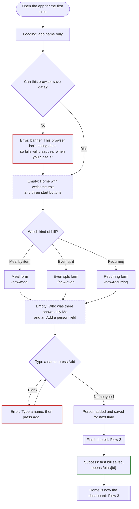
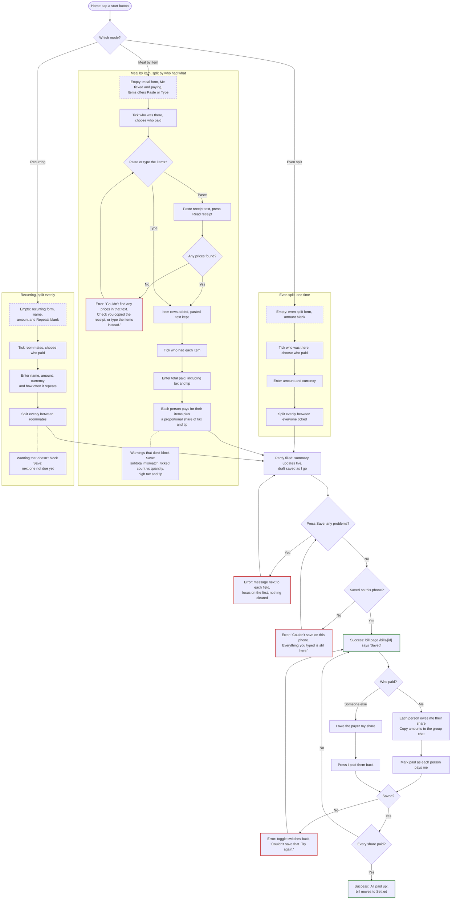
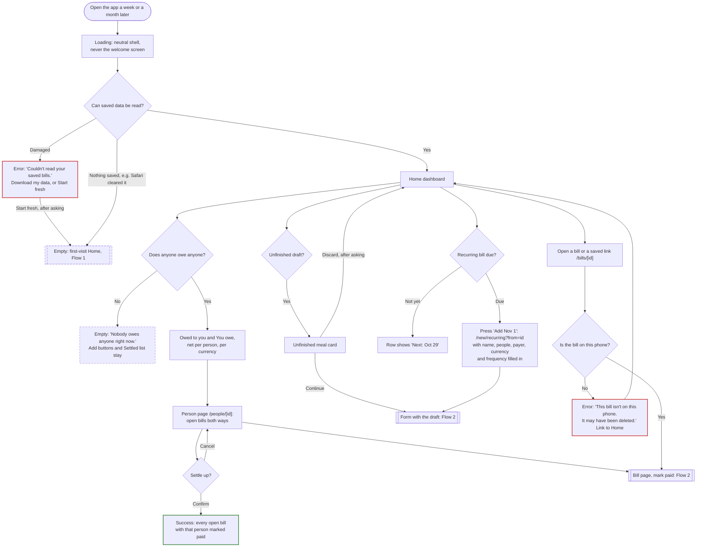

# Flows

Agreed in step 2. These are the screens, routes, states and errors for the three flows: first visit, the main task, and coming back later. Build against this, and change it here when we change our minds.

Main task: add a bill → choose who was there, who paid and how to split it → see who owes whom → mark it paid. Data stays on my phone, and friends never sign in.

## Decisions

| # | Decision | Chosen |
|---|---|---|
| 1 | Modes | Three: **Meal by item**, **Even split (one time)**, **Recurring**. Recurring uses the even-split fields. |
| 2 | Tax and tip input | One "Total paid, including tax and tip" field. Tax and tip are the difference from the items, shared in proportion to each person's items. |
| 3 | Entering meal items | **Paste receipt text** (copied with the phone's built-in text recognition) **or type them in**. Both end up as the same editable item rows. |
| 4 | Who paid | Me or anyone on the bill. Only debts between me and whoever paid are tracked. |
| 5 | Balances | Net per person on Home. **Settle up** on the person page. |
| 6 | Recurring frequency | Weekly, Every 2 weeks, Monthly, or Custom (every N weeks or months). |
| 7 | Currency | Each bill has a currency, defaulting to the last one used. The first default is $ (USD). No conversion: totals are shown per currency. |
| 8 | Person page | Keep |
| 9 | Edit a saved bill | Keep, built after the core flows |
| 10 | Autosaved draft | Keep. One draft at a time. |
| 11 | Copy amounts | Keep, on bills I paid |
| 12 | iPhone data loss | Installable to the Home Screen (web app manifest). Export/Import backup later. |
| 13 | Recurring split | Even only |

## Rules every flow follows

| Route | Screen |
|---|---|
| `/` | Home: empty on the first visit, a dashboard after that |
| `/new/meal` | Meal by item |
| `/new/even` | Even split (one time): Uber rides, or a meal split evenly |
| `/new/recurring` | Recurring bill (`?from=<billId>` fills in the last one) |
| `/bills/[id]` | One bill: who owes whom, mark paid, copy amounts, edit, delete |
| `/bills/[id]/edit` | Edit a bill |
| `/people/[id]` | One person: bills both ways, net balance, Settle up |

- **Who paid:** every bill has one payer. It defaults to Me, and can be anyone ticked on the bill.
- **Debts:** if I paid, everyone else on the bill owes me their share. If someone else paid, I owe them my share. What the others owe them is shown for reference but not tracked.
- **Me:** I'm in every split by default, with my own items. I can untick myself only on a bill I paid.
- **People are saved automatically** the first time I type a name. The picker lists the people I used most recently first.
- **Money is stored in the currency's smallest unit** (cents; yen has none). Shares always add up to the exact total, and leftover units go to whoever paid.
- **Currency:** shown next to the amount field with a **Change** button. The picker lists my recent currencies first, then every other one from the browser's built-in list. Amounts in different currencies are never added together or converted.
- **Loading state:** saved data can only be read in the browser, so each page shows a neutral shell until it has loaded. A returning user never sees a flash of the empty first-visit screen.
- **Number fields** open the decimal keypad and accept `12`, `12.5` or `$12.50`.
- **On Save:** errors appear next to their fields, focus moves to the first one, and nothing typed is cleared.

## Reading the diagrams

Each flow starts with a Mermaid diagram. States are named in the box text, and each kind also has its own outline: **Error:** red, **Empty:** dashed, **Success:** green. Rounded boxes are where a flow starts. Double-edged boxes hand off to another flow.

## Flow 1: First visit, nothing saved

**Screens and routes:** `/`, then the first bill form.



```
Bill Splitter
Split a bill, see who owes whom,
mark it paid. Saved on this phone only.
Friends don't need the app.

[ Split a meal by item  ]
[ Even split (one time) ]
[ Recurring bill        ]
```

| State | What I see |
|---|---|
| Loading | Just the app name, with no buttons yet. |
| Empty | The welcome text and three start buttons above. No sign-up, no tutorial, no asking for my name. |
| Partly filled | On the first form, "Who was there" shows only **Me** plus an "Add a person" field, because nobody is saved yet. |
| Error | Storage blocked (private browsing, or storage turned off) → banner: "This browser isn't saving data, so bills will disappear when you close it. Turn off private browsing to keep them." The app still works for this session. |
| Success | The first bill saves and opens `/bills/[id]`. From then on, Home is the dashboard (Flow 3). |

## Flow 2: Main task (add → split → who owes whom → paid)



### Meal by item: `/new/meal`

The most important form. One page, one column, in receipt order. People come before items because items need people to assign.

```
What was it? (optional)   [ Dinner at Nopa ]
Date                      [ Oct 18, 2026   ]

Who was there
[✓ Me] [✓ Sam] [ Alex ] [✓ Jo]
Add a person [ Name      ] [Add]

Who paid?   (•) Me  ( ) Sam  ( ) Jo

Items   [ Paste receipt text ]  [ Type items ]
  1 × $18.00  Burger
  Who had it  [Me] [Sam ✓] [Jo] [Everyone]
  [Remove item]
  [+ Add item]
Items $84.00 · matches receipt subtotal

Total paid, including tax and tip   $ USD [Change]
[ 102.20 ]
Receipt total $84.00 · [Use this]
Tax and tip $18.20 (22%)

Who owes you
  Sam  $40.25  (items $33.00 + $7.25 tax and tip)
  Jo   $28.10
  Your share $33.85
[ Save bill ]
```

- **Type items** adds a blank row: price, optional name, and who had it.
- **Paste receipt text** opens a box with help text: "On iPhone, open the receipt photo, long-press the text, tap Select All, then Copy." Then a **Read receipt** button. See "Reading a receipt" below.
- A shared item (appetizer, a pitcher) gets ticked for several people, or for **Everyone**, and is split evenly between them.
- Tax and tip (total paid minus the items) are spread in proportion to each person's item subtotal.
- The summary at the bottom updates as I type. When someone else paid, it reads "You owe Sam $33.85", and the others' shares are shown for reference.

### Reading a receipt

- **Items are found by their prices** (`$5.00`), not by line breaks, because the paste often arrives as one long line. Text without a price (order number, date, table) is ignored.
- **A number before the name is the quantity.** "7 Deluxe Ayce Adult $223.93" becomes 7 × $31.99, with the hint "tick 7 people".
- **Reading stops at Subtotal**, so suggested-tip lines ("18% Tip $61.41, You pay $402.56") aren't read as dishes.
- **Subtotal, Tax, Tip/Gratuity and Total are read as labels.** Subtotal checks the items. Total is offered under Total paid ("Use this") but never filled in automatically, because most receipts print the total before tip.
- **Translations** (e.g. 小锅) and other leftover text are dropped from names. Names are optional anyway.
- **Read items are added below any items already there**, as normal rows I can edit, remove or add to. The pasted text stays in the box.
- **Tested on one real receipt** (5 lines, with quantities, bilingual, gratuity included): every item and the subtotal came out right. Test a receipt without quantities before building the parser.

### Even split (one time): `/new/even`

Fields: what was it (defaults to "Uber ride"), date (today), amount and currency, who was there, who paid. Shares are amount ÷ people, with leftover cents going to whoever paid.

### Recurring: `/new/recurring`

Fields: name ("Electricity"), date of this bill, amount and currency, roommates, who paid, and **Repeats**: Weekly, Every 2 weeks, Monthly, or Custom ("Every [N] [weeks / months]"). Split evenly.

- Saving creates a recurring series that remembers the name, people, payer, currency and frequency. If my roommate always pays electricity, that's already set next time.
- **Next due** = this bill's date + the interval. A monthly bill on the 29th–31st falls on the last day of shorter months.
- Changing how often is done by editing the bill.

### The bill: `/bills/[id]`

When I paid:

```
Dinner at Nopa · Oct 18 · $102.20 · You paid
Sam and Jo owe you $68.35 · 0 of 2 paid

Sam   $40.25   [Mark paid]
Jo    $28.10   [Mark paid]
Your share $33.85
[Show breakdown]  (each person's items)

[Copy amounts]  [Edit]  [Delete]
```

When someone else paid:

```
Electricity · Oct 1 · $126.00 · Sam paid
You owe Sam $42.00   [I paid Sam back]
Others' shares (between them and Sam): Jo $42.00

[Edit]  [Delete]
```

- **Mark paid** switches to "Paid · Undo", and **I paid Sam back** switches to "Paid back · Undo". Paid status is just yes or no.
- **Copy amounts** (only on bills I paid) puts text like "Dinner at Nopa (Oct 18): Sam $40.25, Jo $28.10" on the clipboard to paste into the group chat.
- **Edit** opens `/bills/[id]/edit` with the same form, filled in. If a person already marked paid ends up with a different share, they go back to unpaid: "Sam's share changed from $40.25 to $43.10, so they're unpaid again."
- **Delete** asks first: "Delete Dinner at Nopa? This can't be undone."

### States

| State | What I see |
|---|---|
| Empty | Me is ticked and paying in every mode. Meal by item: Items offers Paste or Type, and the summary says "Add who was there and what they had." Even split and recurring: the amount is blank. |
| Partly filled | Meal by item: items entered but no total yet, so the summary shows item subtotals with "+ tax and tip once you enter the total". Even split and recurring: even shares appear once there's an amount and at least one other person. In every mode, the draft is saved as I go. |
| Error | Pressing Save with problems shows each message next to its field and moves focus to the first. Nothing is cleared. |
| Success | Opens `/bills/[id]` with a "Saved" message that screen readers announce. When every share is paid: "All paid up", and the bill moves to Settled. |

### Errors

| Where | Problem | Message |
|---|---|---|
| Who was there | I paid and only Me is ticked | "Add at least one other person to split with." |
| Who paid | Someone else paid and Me isn't ticked | "You're not on this bill, so you don't owe anything. Tick Me, or pick yourself as who paid." |
| Who paid | The payer isn't ticked | "Sam paid, so tick Sam under Who was there, or choose who paid." |
| Add a person | Blank | "Type a name, then press Add." |
| Add a person | Name already saved | "Sam is already in the list. Tap their name to include them." |
| Paste box | Empty | "Paste the receipt text first, or type the items instead." |
| Paste box | No prices found | "Couldn't find any prices in that text. Check you copied the receipt, or type the items instead." |
| Item price | Blank or not a number | "Enter a price, like 12.50." |
| Item price | 0 or less | "Enter a price above 0." |
| Item | Nobody ticked | "Choose who had this item." |
| Items | No items | "Add at least one item from the receipt." |
| Total paid | Blank | "Enter the total you paid, including tax and tip." |
| Total paid | Less than the items | "That's less than the items ($84.00). Check the total, or remove an item that isn't on the receipt." |
| Amount (even split, recurring) | Blank or invalid | "Enter the amount, like 24.80." |
| Name (recurring) | Blank | "Name this bill, like Electricity." |
| Repeats (custom) | Blank, or outside 1–52 weeks or 1–12 months | "Enter how often, like every 3 months." |
| Save | Storage full or blocked | Shown near Save: "Couldn't save on this phone. Everything you typed is still here. Try again." |
| Mark paid | Couldn't save | The toggle switches back, with "Couldn't save that. Try again." |

**Warnings that don't block Save:**
- "Jo isn't on any item, so they owe $0. Tick them on an item or remove them."
- "This line is for 7 people. You've ticked 5."
- "Items add up to $250.00, but the receipt subtotal is $258.93. A line may be missing."
- "Tax and tip come to 45% of the items. Check the total."
- On a recurring bill: "The next Electricity isn't due until Nov 1."

**Unticking a person** who's on items takes them off those items. Any item left with nobody shows its "Choose who had this item" error.

## Flow 3: Coming back next week or next month

**Screens and routes:** `/` (dashboard), `/bills/[id]`, `/people/[id]` and `/new/recurring?from=<id>`.



```
[ Split a meal ] [ Even split ] [ Recurring ]

Unfinished meal from Tue   [Continue] [Discard]

Owed to you  $68.35
  Jo    $28.10 · 1 bill    >
You owe  $1.75
  Sam   $1.75 · 2 bills    >

Recurring
  Electricity · monthly · Sam pays   [Add Nov 1]
  Internet · every 2 weeks · you pay   Next: Oct 29

Bills
  Dinner at Nopa · Oct 18 · 0 of 2 paid
  Electricity · Oct 1 · Sam paid · not paid back
  > Settled (6)
```

- **Net per person:** Sam owes me $40.25 for dinner and I owe Sam $42.00 for electricity, so Home shows "You owe Sam $1.75". Balances in different currencies are shown side by side, for example "$1.75 · ¥2,400", and never netted against each other.
- **Settle up:** tapping a person opens `/people/[id]`. It lists every open bill between us in both directions, each with its own Mark paid, plus **Settle up**, which asks first: "Settle up with Sam? This marks 2 bills as paid. You pay Sam $1.75."
- **Recurring:** "Add Nov 1" appears once the next one is due. It opens the recurring form with the name, people, payer, currency and frequency filled in, and focus on the empty amount field. Before then, the row shows "Next: Oct 29". Nothing is created automatically.

| State | What I see |
|---|---|
| Loading | The neutral shell. Never the empty welcome screen. |
| Open bills | The dashboard above, with unpaid bills first. |
| Partly settled | Each bill shows "1 of 3 paid". Each person shows their net balance. |
| All settled | "Nobody owes anyone right now." The add buttons and Settled list stay. |
| Draft waiting | The "Unfinished…" card. Discard asks first. |
| Recurring due | "Add Nov 1" on that row. Before then, "Next: Nov 1". |

### Errors

- **Saved data can't be read** (damaged, or from an older version) → "Couldn't read your saved bills." The data isn't wiped silently. Instead there are two choices: **Download my data** (a file) or **Start fresh** (asks first).
- **Bill or person not found** (deleted, or a link opened on another device) → "This bill isn't on this phone. It may have been deleted." plus a link to Home.
- **iPhone risk:** Safari can delete a site's saved data after 7 days of using Safari without opening the site. Sites added to the Home Screen are exempt, so the app is installable to the Home Screen.

## Cut

- **Partial payments** ("Sam paid $20 of $40"): paid is yes or no only.
- **Debts between two other people:** only debts with me are tracked.
- **One bill paid by two people**
- **Uneven recurring splits** (rent by room size)
- **Recurring every N days**
- **Currency conversion:** it would need exchange rates from an outside service.
- **Discounts and coupons on meals:** a total below the items counts as an error.
- **Reading the photo inside the app** (an OCR package or an AI API): the phone's own text recognition plus paste covers it.
- **Groups** ("Roommates")
- **A page to manage people** (rename or delete)
- **Automatic recurring bills and reminders**
- **Search and filters** on the bills list
- **Keeping two open tabs in sync**
- **Export/Import backup** (later, not now)
- **Links that friends can view, syncing between devices:** ruled out by the constraints in AGENTS.md.
