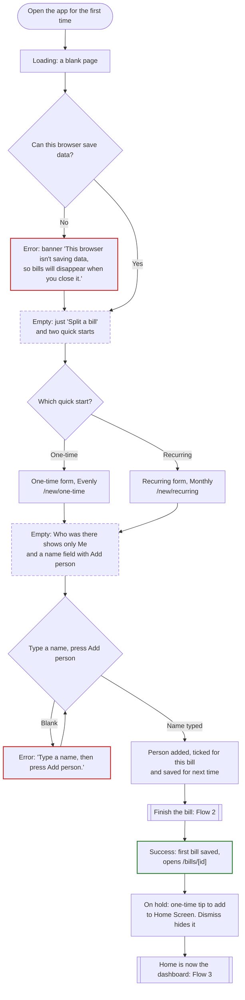
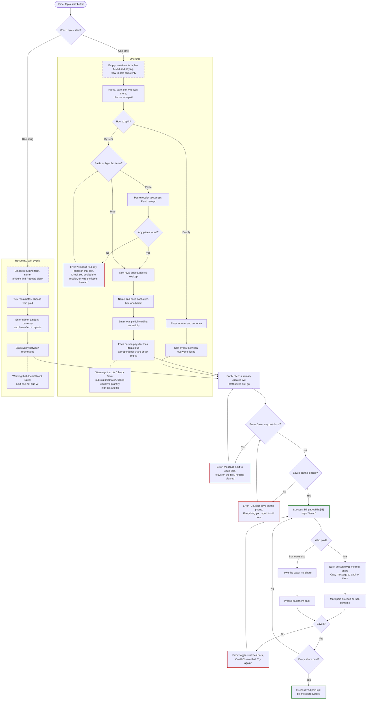

# Flows

Agreed in step 2. These are the screens, routes, states and errors for the three flows: first visit, the main task, and coming back later. Build against this, and change it here when we change our minds.

Main task: add a bill → choose who was there, who paid and how to split it → see who owes whom → mark it paid. Data stays on my phone, and friends never sign in.

## Decisions

| # | Decision | Chosen |
|---|---|---|
| 1 | Modes | Two quick starts: **One-time** ("A meal, ride, or anything once") and **Recurring** ("Rent, subscription, or anything that repeats"; Monthly preselected). One-time opens on **How to split: Evenly**, the shortest form, with **By item** one tap away. Recurring is always even. |
| 2 | Tax and tip input | One "Total paid, including tax and tip" field. Tax and tip are the difference from the items, shared in proportion to each person's items. |
| 3 | Entering meal items | **Paste receipt text** (copied with the phone's built-in text recognition) **or type them in**. Both end up as the same editable item rows. |
| 4 | Who paid | Me or anyone on the bill. Only debts between me and whoever paid are tracked. |
| 5 | Balances | Home lists **Who owes you** and **You owe** separately, each person with how long it's been unpaid. Netting the two and **Settle up** come with the person page. |
| 6 | Recurring frequency | Weekly, Every 2 weeks, Monthly, or Custom (every N weeks or months). |
| 7 | Currency | Each bill has a currency, defaulting to the last one used. The first default is $ (USD). No conversion: totals are shown per currency. |
| 8 | Person page | Keep |
| 9 | Edit a saved bill | Keep, built after the core flows |
| 10 | Autosaved draft | Keep. One draft at a time. |
| 11 | Copy message | One per person on bills I paid: the bill's name and date, what they had and what each part came to, then their total. Friendlier than "you owe me $X". |
| 12 | iPhone data loss | Installable to the Home Screen (web app manifest), suggested once after the first bill is saved. Export/Import backup later. **On hold:** on iPhone, a site added to the Home Screen gets its own storage, separate from Safari's, so bills saved before adding it wouldn't show up there. Decide how to handle that before building the tip. |
| 13 | Recurring split | Even only |
| 14 | New people and hints (from research.md) | Someone I've just added is ticked for this bill. Fields show example hints. No sample bills. |

## Rules every flow follows

| Route | Screen |
|---|---|
| `/` | Home: empty on the first visit, a dashboard after that |
| `/new/one-time` | One-time bill: How to split starts on Evenly |
| `/new/recurring` | Recurring: a recurring bill with Monthly preselected (`?series=<id>` fills in last time's details for the next bill) |
| `/bills` | All bills, newest first, grouped by month ("See all" on Home) |
| `/bills/[id]` | One bill: each person's share and how it was worked out, Mark paid, Copy message, edit, delete |
| `/bills/[id]/edit` | Edit a bill |
| `/people/[id]` | One person: bills both ways, net balance, Settle up |

- **Navigation:** no tabs and no header bar. On every page except Home, the app name sits at the top on the same background and goes back to Home. Home has none: a first visit is just "Split a bill", and coming back, "Bill Splitter" is Home's own big title. Home's quick starts are how a bill starts, and each page's title says where you are.
- **Who paid:** every bill has one payer, picked with radio dots so it doesn't look like the tick-many people chips. It defaults to Me, and can be anyone ticked on the bill.
- **Debts:** if I paid, everyone else on the bill owes me their share. If someone else paid, I owe them my share. What the others owe them is shown for reference but not tracked.
- **Me:** I'm in every split by default, with my own items. I can untick myself only on a bill I paid.
- **People are saved automatically** with the bill: anyone typed in with **Add person** who's still ticked when I press Save. Someone I've just added is ticked straight away, and Enter adds them and keeps the cursor there, so names can be typed one after another. People saved from earlier bills stay unticked until I tap them. The picker lists the people I used most recently first.
- **Money is stored in the currency's smallest unit** (cents; yen has none). Shares always add up to the exact total, and leftover units go to whoever paid.
- **Currency:** shown next to the amount field with a **Change** button. The picker lists my recent currencies first, then every other one from the browser's built-in list. Amounts in different currencies are never added together or converted.
- **Loading state:** saved data can only be read in the browser, so each page shows a neutral shell until it has loaded. A returning user never sees a flash of the empty first-visit screen.
- **Number fields** open the decimal keypad and accept `12`, `12.5` or `$12.50`.
- **Look:** the Greek Summer design system from the recipe-book project: navy on warm white, Aegean blue only for the main action, light-blue fill for anything selected, pill buttons and chips, 12px fields, 20px cards with a thin limestone line and no shadows. Light only, no illustrations.
- **Type:** one set of roles, so the same kind of thing always looks the same (defined in `app/globals.css`):

  | Role | Used for | Style |
  |---|---|---|
  | Display | Home's "Bill Splitter" | Marcellus 40px |
  | Heading | page titles | Marcellus 28px |
  | Title | card titles, the app name | Marcellus 22px |
  | Lead | a key figure: "Josh owes you $58.16", a share | Manrope 20px semibold |
  | Row | every list row's name and amount | Manrope 17px medium |
  | Body | sentences, inputs | Manrope 17px regular |
  | Control | buttons, chips, checkboxes | Manrope 15px semibold |
  | Small | second lines, hints, breakdowns | Manrope 14px regular |
  | Label | section and field labels | Manrope 12px bold uppercase |

  Money is never in Marcellus (its numerals look very different). It takes the role of where it sits, always with even-width digits.
- **Labels:** no question marks ("Who paid", not "Who paid?"), and no "(optional)": every field on a bill is needed, including each item's name.
- **Hints:** fields show an example under their label, such as "Like Dinner at Nopa" or "Like 12.50". Placeholders never stand in for labels. There are no sample bills, because fake bills would mix into real balances.
- **On Save:** errors appear next to their fields, focus moves to the first one, and nothing typed is cleared.

## Reading the diagrams

Each flow starts with a Mermaid diagram. States are named in the box text, and each kind also has its own outline: **Error:** red, **Empty:** dashed, **Success:** green. Rounded boxes are where a flow starts. Double-edged boxes hand off to another flow.

## Flow 1: First visit, nothing saved

**Screens and routes:** `/`, then the first bill form.



```


Split a bill                (centred about a third of the way down the screen,
                             nothing above it, wider side margins)

[ One-time    A meal, ride, or anything once               ]
[ Recurring   Rent, subscription, or anything that repeats ]
```

| State | What I see |
|---|---|
| Loading | A blank page until saved data is read, with no app name and no buttons. |
| Empty | Just "Split a bill" and the two quick starts: no app name, no illustration, no explanation. No sign-up, no tutorial, no asking for my name. |
| Partly filled | On the first form, "Who was there" shows only **Me** plus a name field with an **Add person** button on its right, because nobody is saved yet. Anyone I add is ticked straight away. |
| Error | Storage blocked (private browsing, or storage turned off) → banner: "This browser isn't saving data, so bills will disappear when you close it. Turn off private browsing to keep them." The app still works for this session. |
| Success | The first bill saves and opens `/bills/[id]` with a "Saved" message. **On hold (see Decision 12):** below the amounts, a one-time tip: "Add Bill Splitter to your Home Screen so your bills are kept. On iPhone: Share, then Add to Home Screen." It has a **Dismiss** button, and Dismiss hides it for good. It never appears before or during the first bill, and not at all if the app is already on the Home Screen. From then on, Home is the dashboard (Flow 3). |

## Flow 2: Main task (add → split → who owes whom → paid)



### One-time, by item: `/new/one-time`

The most important form. One page, one column, in receipt order. People come before items because items need people to assign.

```
Name                      [ Dinner at Aba  ]
Date                      [ Oct 18, 2026   ]

Who was there
New names are saved for next time.
[✓ Me] [✓ Sam] [ Alex ] [✓ Jo]
[ Name                    ] [Add person]

Who paid   (•) Me  ( ) Sam  ( ) Jo

How to split   [✓ By item] [ Evenly ]

Items
  [Paste receipt text]  → Receipt text [ … ]  [Read receipt]
  Name   [ Burger ]
  Price  [ 18.00  ]
  Who had it  [Me] [Sam ✓] [Jo] [Everyone]
  [Remove item]
  [+ Add item]
Items $84.00 · matches receipt subtotal

Total paid, including tax and tip   $ USD [Change]
[ 102.20 ]
Receipt total $84.00. Add any extra tip you left. [Use this]
Tax and tip $18.20 (22%)

Who owes you
  Sam  $40.25  (items $33.00 + $7.25 tax and tip)
  Jo   $28.10
  Your share $33.85
[ Save bill ]
```

- **Type items** adds a blank item: name, then price, then who had it.
- **Paste receipt text** opens a box with help on copying the text, then **Read receipt** fills in the items. See "Reading a receipt" below.
- A shared item (appetizer, a pitcher) gets ticked for several people, or for **Everyone**, and is split evenly between them.
- Tax and tip (total paid minus the items) are spread in proportion to each person's item subtotal.
- The summary at the bottom updates as I type. When someone else paid, it reads "You owe Sam $33.85", and the others' shares are shown for reference.

### Reading a receipt

Built in Step 16 (`lib/receipt.ts`). Everything happens on the phone; nothing is uploaded.

- **Paste receipt text** sits at the top of Items (By item only). It opens a box labelled "Receipt text", with help: "On iPhone, open the receipt photo, press and hold the text, tap Select All, then Copy. On Android, use Google Lens to copy the text." Then **Read receipt**.
- **Items are found by their prices** (`$5.00`, `223.93`, `$1,250.00`), not by line breaks, because the paste often arrives as one long line. Text without a price (order number, date, table) is ignored, and $0.00 lines (like "No onions") are skipped.
- **A number before the name is the quantity:** "7 Deluxe Ayce Adult $223.93" or "2 x Beer $14.00". The item shows "7 × $31.99 on the receipt: tick 7 people", and a warning appears if a different number is ticked.
- **Reading stops at the summary.** The summary starts at the first label followed by a price: Subtotal, Tax, GST, HST, VAT, Tip, Gratuity, Service charge, Total, Grand total, Amount due. So suggested-tip lines after the total ("18% Tip $61.41, You pay $402.56") are never read as dishes. An item merely named like a label ("Tip-top cake") isn't mistaken for it, because no price follows the label.
- **Subtotal, Tax, Tip and Total are read as labels.** Subtotal checks the items: "Items add up to $250.00, but the receipt subtotal is $258.93. A line may be missing." Total is offered under Total paid ("Receipt total $341.15. Add any extra tip you left. [Use this]") but never filled in automatically, because most receipts print the total before tip.
- **Names** are the words before the price, after any quantity. Translations after a price (e.g. 小锅) and leftover symbols are dropped. Names can be edited like any typed item.
- **Read items are added below any items already there**, as normal items I can edit, remove or add to. An untouched blank first item is replaced. The pasted text stays in the box, even when switching between By item and Evenly. A message says what was found: "Found 5 items, subtotal $258.93. Check them, then tick who had each one."
- **Errors:** an empty box gives "Paste the receipt text first, or type the items instead.", and text with no prices gives "Couldn't find any prices in that text. Check you copied the receipt, or type the items instead."
- **Tested** on the real hot pot receipt (one line, bilingual, quantities, gratuity, suggested tips after the total), a line-by-line receipt with no $ signs or quantities, and one with "2 x", a $0.00 modifier, thousands and a percent before the tip.
### One-time, evenly: `/new/one-time`

Fields: name, date (today), who was there, who paid, How to split (Evenly), then the amount and currency. Shares are amount ÷ people, with leftover cents going to whoever paid.

### Recurring: `/new/recurring`

Fields: name ("Electricity"), date of this bill, amount and currency, roommates, who paid, and **Repeats**: Weekly, Every 2 weeks, Monthly, or Custom ("Every [N] [weeks / months]"). Split evenly.

- Saving creates a recurring series that remembers the name, people, payer, currency and frequency. If my roommate always pays electricity, that's already set next time.
- **Next due** = this bill's date + the interval. A monthly bill on the 29th–31st falls on the last day of shorter months.
- Changing how often is done by editing the bill.

### The bill: `/bills/[id]`

When I paid:

```
Dinner at Aba
Oct 18 · $102.20 · You paid
Josh owes you $40.25
1 of 2 paid

┌ Josh                               $40.25 ┐
│ Owes you                                  │
│ Lamb shoulder                      $38.00 │
│ Mezze, shared by 3                  $8.00 │   ← their items
│ Items                              $46.00 │
│ Tax and tip (26% of items)        +$12.16 │   ← their share of tax and tip
│ [ ] Mark paid            [Copy message]   │
└───────────────────────────────────────────┘
┌ Julie                       ~~$28.10~~    ┐
│ Paid you back  …breakdown…  [✓] Mark paid │
└───────────────────────────────────────────┘
┌ Your share                         $33.85 ┐
│ …breakdown…                               │
└───────────────────────────────────────────┘

[Delete bill]   (Edit comes later)
```

When someone else paid:

```
Electricity
Oct 1 · $126.00 · Sam paid · Repeats monthly
You owe Sam $42.00

┌ Your share                         $42.00 ┐
│ You owe Sam                               │
│ $126.00 split 3 ways                      │
│ [ ] Mark paid                             │
└───────────────────────────────────────────┘
Others' shares, between them and Sam: Jo $42.00

[Delete bill]   (Edit comes later)
```

- **Each person has a card** with their share and how it was worked out. By item: their items (shared ones say "shared by 3" and show their part), the items subtotal, then their share of tax and tip with the rate ("Tax and tip (26% of items) +$12.16"). The lines add up to their share. Evenly: "$90.00 split 3 ways". My own share gets a card too, without the controls.
- **Mark paid** is a checkbox on each card. Tick it when that person pays you back, one at a time; untick to undo. Paid amounts are struck through. The heading names only who still owes you, with "1 of 2 paid" under it, and becomes "All paid up" (with "Everyone's paid you back.") once the last one is ticked. On a bill someone else paid, **Mark paid** on my card means I've paid them back. Paid is just yes or no.
- **Home's list** shows each bill's status: "1 of 2 paid", "All paid up", "Not paid back yet" or "Paid back".
- **Copy message** is on each unpaid person's card (only on bills I paid). It copies a short, friendly breakdown to send them, matching their card, so friends never need the app:

  ```
  Dinner at Aba (Oct 5)
  Lamb shoulder: $38.00
  Mezze (shared by 3): $8.00
  Tax and tip: $12.16
  Your total: $58.16
  ```

  An even split reads "Uber home (Oct 19) / $24.80 split 2 ways / Your total: $12.40".
- **Home's "Who owes you"** adds up what each person owes across all bills I paid (per currency, never converted), with the bills it's for as links: "Josh $70.25. For Dinner at Aba ($40.25), Uber home ($30.00)".
- **Edit** opens `/bills/[id]/edit` with the same form, filled in. If a person already marked paid ends up with a different share, they go back to unpaid: "Sam's share changed from $40.25 to $43.10, so they're unpaid again."
- **Delete bill** sits at the bottom of the bill page. It asks first, inline: "Delete Dinner at Aba? This can't be undone.", with a red **Delete bill** and **Cancel**. Focus moves into the question, and back to "Delete bill" on Cancel. Deleting goes back to Home with "Deleted Dinner at Aba." If it was the only bill in a recurring series, the series goes too, so it doesn't stay "due". Saved people stay. Red is used only for this confirmation.

### States

| State | What I see |
|---|---|
| Empty | Me is ticked and paying in every mode. By item: Items offers Paste or Type, and the summary says "Add who was there and what they had." Evenly and recurring: the amount is blank. |
| Partly filled | By item: items entered but no total yet, so the summary shows item subtotals with "+ tax and tip once you enter the total". Evenly and recurring: even shares appear once there's an amount and at least one other person. In every mode, the draft is saved as I go. |
| Error | Pressing Save with problems shows each message next to its field and moves focus to the first. Nothing is cleared. |
| Success | Opens `/bills/[id]` with a "Saved" message that screen readers announce. When every share is paid: "All paid up", and the bill moves to Settled. |

### Errors

| Where | Problem | Message |
|---|---|---|
| Who was there | I paid and only Me is ticked | "Add at least one other person to split with." |
| Who paid | Someone else paid and Me isn't ticked | "You're not on this bill, so you don't owe anything. Tick Me, or pick yourself as who paid." |
| Who paid | The payer isn't ticked | "Sam paid, so tick Sam under Who was there, or choose who paid." |
| Add person | Blank | "Type a name, then press Add person." |
| Add person | Name already saved | "Sam is already in the list. Tap their name to include them." |
| Add person | Name already on this bill | "Sam is already on this bill." |
| Add person | "Me" or "You" | "You're already on the list as Me." |
| Add person | A name typed but not added when Save is pressed | "Press Add person to put Jo on this bill, or clear the name." |
| Paste box | Empty | "Paste the receipt text first, or type the items instead." |
| Paste box | No prices found | "Couldn't find any prices in that text. Check you copied the receipt, or type the items instead." |
| Item name | Blank | "Name this item, like Burger." |
| Item price | Blank or not a number | "Enter a price, like 12.50." |
| Item price | 0 or less | "Enter a price above 0." |
| Item | Nobody ticked | "Choose who had this item." |
| Items | No items | "Add at least one item from the receipt." |
| Total paid | Blank | "Enter the total you paid, including tax and tip." |
| Total paid | Not a number | "Enter the total as a number, like 102.20." |
| Total paid | Less than the items | "That's less than the items ($84.00). Check the total, or remove an item that isn't on the receipt." |
| Amount (even split, recurring) | Blank or invalid | "Enter the amount, like 24.80." |
| Amount (even split, recurring) | 0 | "Enter an amount above 0." |
| Date | Blank or not a real date | "Enter the date of the bill." |
| Name | Blank | "Name this bill, like Dinner at Aba." On a recurring bill: "Name this bill, like Electricity." |
| Repeats (custom) | Blank, or outside 1–52 weeks or 1–12 months | "Enter how often, like every 3 months." |
| Save | Storage full or blocked | Shown near Save: "Couldn't save on this phone. Everything you typed is still here. Try again." |
| Mark paid | Couldn't save | The box stays as it was, with "Couldn't save that. Try again." |
| Delete bill | Couldn't save | The bill stays, with "Couldn't delete it. Try again." under the question. |

**Warnings that don't block Save:**
- "Jo isn't on any item, so they owe $0. Tick them on an item or remove them."
- "This line is for 7 people. You've ticked 5."
- "Items add up to $250.00, but the receipt subtotal is $258.93. A line may be missing."
- "Tax and tip come to 45% of the items. Check the total."
- On a recurring bill: "The next Electricity isn't due until Nov 1."

**Unticking a person** who's on items takes them off those items. Any item left with nobody shows its "Choose who had this item" error.

## Flow 3: Coming back next week or next month

**Screens and routes:** `/` (Home, coming back), `/bills/[id]`, `/people/[id]` (later) and `/new/recurring?series=<id>`.


```
Bill Splitter                      (big: Home's title, no header above)
You're owed $133.56. You owe $60.00. 1 recurring bill is due.

[ One-time    A meal, ride, or anything once               ]  ← the big cards lead
[ Recurring   Rent, subscription, or anything that repeats ]

WHO OWES YOU
  Jo     $63.00   Unpaid for 2 weeks · For Electricity (Oct 1, $63.00)
  Josh   $58.16   Unpaid for 2 weeks · For Dinner at Aba (Oct 5, $58.16)
  Sam    $12.40   Unpaid since today · For Uber home (Oct 19, $12.40)

YOU OWE
  Jo     $60.00   Unpaid for 2 months · For Internet (Aug 15, $30.00),
                  Internet (Sep 15, $30.00)

RECURRING BILLS
  Internet · Monthly · Jo pays · Due Oct 15        [Add Oct 15]
  Electricity · Monthly · you pay · Next Nov 1

RECENT BILLS                       (the 5 newest, latest at the top)
  Uber home · Oct 19 · Sam owes you $12.40         $24.80
  Dinner at Aba · Oct 5 · Josh owes you $58.16     $78.40
  …
See all 6 bills                    (→ /bills, by month)
```

- **First visit or coming back:** with no bills saved, Home is the first-visit screen (Flow 1). With any bill, it's this one. Until saved data is read, it shows the neutral shell, never the wrong one.
- **Hierarchy:** a big "Bill Splitter" (Home's title) and one summary line. Next come the two big new-bill cards (the same as on a first visit; One-time is the Aegean-blue main action), so starting a bill always comes first. The sections below have quiet small-uppercase labels, and every list uses the same rows (Row type for names and amounts, Small for the second line), in this order: Who owes you and You owe (kept together), Recurring bills, Recent bills.
- **Recent bills:** the 5 newest, latest at the top, each with who still owes on it ("Sam owes you $12.40"). If there are more, **See all N bills** opens `/bills`, every bill grouped by month, in the same rows.
- **Who owes you:** one row per person: what they owe across all bills I paid, **how long** it's been unpaid (from their oldest unpaid bill: "since today", "for 3 days", "for 2 weeks", "for 2 months"; a month or more is in bold), and the bills it's for, as links with dates. Paid shares drop off.
- **You owe:** the same, for bills someone else paid where my share isn't paid back yet.
- **Not netted:** someone can appear in both lists. Netting them ("You owe Sam $1.75 overall") and **Settle up** come with the person page, `/people/[id]`, which isn't built yet. Different currencies sit side by side ("$1.75 · ¥2,400") and are never added together.
- **Recurring bills:** due ones first, each with **Add Oct 15**. That opens `/new/recurring?series=<id>` with the name, people, payer and how often filled in, dated when it was due, and the cursor in Amount, which is blank because it changes each time. Saving continues the same series. Others show "Next Nov 1". Monthly bills keep the first bill's day (a bill on the 31st is due Apr 30, then May 31). Nothing is created automatically.

| State | What I see |
|---|---|
| Loading | The neutral shell. Never the empty welcome screen. |
| Open bills | "Bill Splitter" with the sections above. |
| Partly settled | Each bill shows "1 of 3 paid", and paid shares drop out of Who owes you. |
| All settled | "Nobody owes anyone right now." The new-bill cards, Recurring bills and Recent bills stay. |
| Recurring due | "Add Oct 15" on that row and "1 recurring bill is due." in the summary. Before then, "Next Nov 1". |
| Draft waiting | Later: an "Unfinished…" card. Discard asks first. |

### Errors

- **Saved data can't be read** (damaged, or from an older version) → "Couldn't read your saved bills." The data isn't wiped silently. Instead there are two choices: **Download my data** (a file) or **Start fresh** (asks first).
- **Bill or person not found** (deleted, or a link opened on another device) → "This bill isn't on this phone. It may have been deleted." plus a link to Home.
- **iPhone risk:** Safari can delete a site's saved data after 7 days of using Safari without opening the site. Sites added to the Home Screen are exempt, so the app is installable to the Home Screen and suggests it once, after the first bill is saved.

## Cut

- **Partial payments** ("Sam paid $20 of $40"): paid is yes or no only.
- **Debts between two other people:** only debts with me are tracked.
- **One bill paid by two people**
- **Uneven recurring splits** (rent by room size)
- **Recurring every N days**
- **Currency conversion:** it would need exchange rates from an outside service.
- **Discounts and coupons on meals:** a total below the items counts as an error.
- **Reading the photo inside the app** (an OCR package or an AI API): the phone's own text recognition plus paste covers it.
- **Groups** ("Roommates"): add them later only if people using the app ask for them.
- **A page to manage people** (rename or delete)
- **Automatic recurring bills and reminders**
- **Search and filters** on the bills list
- **Keeping two open tabs in sync**
- **Export/Import backup** (later, not now)
- **Links that friends can view, syncing between devices:** ruled out by the constraints in AGENTS.md.
